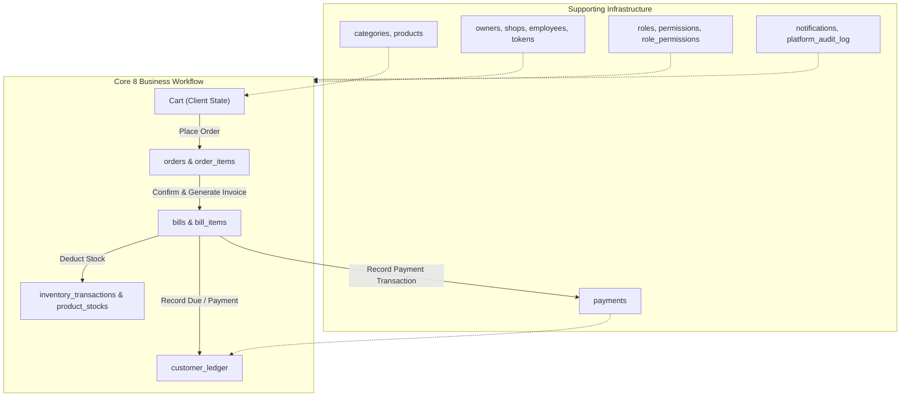

# NSYU Business — Database Cleanup & Simplification Plan

**Target Architecture:** 8 Core Business Tables + Essential Supporting Tables  
**Safety Protocol:** Zero Data Loss • No Destructive SQL Without Approval • Backward Compatibility Guaranteed

---

## 1. Cleanup Objectives

1. Eliminate genuinely unused modules (`emi_plans`, `emi_installments`, `sale_return_items`, `purchase_returns`, `payrolls`, `attendance`).
2. Establish the authoritative 8-table business foundation (`customers`, `customer_ledger`, `orders`, `order_items`, `bills`, `bill_items`, `products`, `inventory_transactions`).
3. Preserve all verified supporting tables (`owners`, `shops`, `employees`, `roles`, `permissions`, `product_stocks`, `payments`, `notifications`, `audit_logs`, `tokens`).
4. Retain 100% API and UI compatibility by using PostgreSQL backward-compatible views where necessary (`sales` view pointing to `bills`, `sale_items` view pointing to `bill_items`).

---

## 2. Table-by-Table Disposition Matrix

### Category A: The 8 Core Business Tables (Mandatory)
| Table | Current State | Proposed Action | Impact on Codebase |
|---|---|---|---|
| `customers` | Exists (1 row) | **KEEP** | Core customer identity and balance |
| `customer_ledger` | Exists (0 rows) | **KEEP** | Core financial ledger (Debit on bill, Credit on payment) |
| `orders` | Exists (0 rows) | **KEEP** | Customer orders |
| `order_items` | Exists (0 rows) | **KEEP** | Order items |
| `bills` | Missing (0 rows) | **CREATE** | Authoritative invoice and billing master |
| `bill_items` | Missing; `sale_items` exists | **TRANSITION** | Create `bill_items` from `sale_items` schema; create view `sale_items` |
| `products` | Exists (184 rows) | **KEEP** | Master catalog (all SKUs, prices, margins) |
| `inventory_transactions` | Exists (0 rows) | **KEEP** | Stock in/out history audit trail |

---

### Category B: Retained Supporting Tables
| Table | Current State | Reason to Retain |
|---|---|---|
| `owners` | Exists (2 rows) | Multi-tenant owner credentials & authentication |
| `shops` | Exists (1 row) | Outlet master, invoice prefix, GST, business settings |
| `employees` | Exists (0 rows) | Staff logins and manager assignment |
| `roles` | Exists (18 rows) | Role definitions (super_admin, owner, manager, staff, cashier) |
| `permissions` | Exists (0 rows) | Granular permission registry |
| `role_permissions` | Exists (448 rows) | Role-to-permission mappings |
| `role_field_permissions` | Exists (112 rows) | Dynamic field masking (profit, cost, customer balance) |
| `product_stocks` | Exists (90 rows) | Real-time shop-wise inventory counts |
| `categories` | Exists (8 rows) | Product catalog categories |
| `subcategories` | Exists (0 rows) | Subcategory hierarchy |
| `payments` | Exists (0 rows) | Payment transactions (Cash, UPI, Card, Bank) |
| `notifications` | Exists (0 rows) | Real-time operational in-app notification center |
| `platform_audit_log` | Exists (0 rows) | System action & security audit trail |
| `status_history` | Exists (0 rows) | Shop/order state transition logs |
| `invoice_counters` | Exists (0 rows) | Atomic sequential invoice number generator (`INV-NSYU-000001`) |
| `reference_counters` | Exists (0 rows) | Atomic order number generator (`ORD-000001`) |
| `refresh_tokens` | Exists (0 rows) | JWT session management & token rotation |
| `customer_refresh_tokens`| Exists (0 rows) | Customer portal session security |

---

### Category C: Unnecessary Module Candidates (Proposed for Removal)
All tables in this category currently have **0 live rows**.

| Table | Module | Justification for Removal | Dependent Code to Clean |
|---|---|---|---|
| `emi_plans` | EMI | Modern retail billing uses instant payment / udhaar ledger tracking. Unused. | `api/src/controllers/emiController.ts`, `api/src/models/EMIPlan.ts` |
| `emi_installments` | EMI | Installment schedules not used. Replaced by direct customer ledger. | `api/src/controllers/emiController.ts`, `api/src/models/EMIInstallment.ts` |
| `sale_return_items` | Returns | Return items table has 0 rows. Can be archived. | `api/src/controllers/saleReturnController.ts` |
| `purchase_returns` | Purchases | Purchase return workflow has 0 rows. | `api/src/models/PurchaseReturn.ts` |
| `purchase_return_items`| Purchases | Purchase return line items has 0 rows. | `api/src/models/PurchaseReturnItem.ts` |
| `purchases` | Purchases | Supplier purchase orders are not used in current retail operations. | `api/src/controllers/purchaseController.ts` |
| `purchase_items` | Purchases | Purchase order line items. 0 rows. | `api/src/models/PurchaseItem.ts` |
| `purchase_counters` | Purchases | Sequential counter for purchase orders. 0 rows. | `api/src/models/PurchaseCounter.ts` |
| `suppliers` | Suppliers | 1 placeholder row. Supplier data can live in simple reference notes if needed. | `api/src/controllers/supplierController.ts` |
| `attendance` | HR/Payroll | Daily clock-in/clock-out tracking. 0 rows. | `api/src/controllers/attendanceController.ts` |
| `leave_requests` | HR/Payroll | Staff leave requests. 0 rows. | `api/src/controllers/leaveController.ts` |
| `payrolls` | HR/Payroll | Monthly payroll calculation. 0 rows. | `api/src/controllers/payrollController.ts` |
| `salary_configs` | HR/Payroll | Staff salary configuration. 0 rows. | `api/src/models/SalaryConfig.ts` |
| `salary_payments` | HR/Payroll | Salary payout records. 0 rows. | `api/src/models/SalaryPayment.ts` |
| `employee_advances` | HR/Payroll | Staff advance salary records. 0 rows. | `api/src/models/EmployeeAdvance.ts` |
| `employee_incentives`| HR/Payroll | Staff incentive records. 0 rows. | `api/src/models/EmployeeIncentive.ts` |
| `employee_ledger` | HR/Payroll | Employee debit/credit ledger. 0 rows. | `api/src/models/EmployeeLedger.ts` |
| `employee_shops` | HR | Redundant join table; employee shop assignment lives directly on `employees`. | `api/src/models/EmployeeShop.ts` |
| `customer_carts` | Cart | Client applications maintain cart in active app state. DB cart has 0 rows. | `api/src/controllers/customerCartController.ts` |
| `customer_otps` | Auth | Ephemeral OTPs can be handled in-memory or Supabase Auth. 0 rows. | `api/src/controllers/customerAuthController.ts` |
| `product_images` | Catalog | Images are stored directly as URLs on `products.image_url`. 0 rows. | `api/src/models/ProductImage.ts` |
| `product_locations` | Inventory | Bin/shelf warehouse coordinates are unused. 0 rows. | `api/src/models/ProductLocation.ts` |
| `stock_transfers` | Inventory | Inter-store transfers not needed for current single retail store. 0 rows. | `api/src/controllers/stockTransferController.ts` |
| `modules` | RBAC | Static system modules. Permissions can be mapped directly to roles. | `api/src/models/Module.ts` |

---

## 3. Safe Migration Architecture

---

## 4. Execution Guardrails

1. **Explicit Approval Gate:** No database changes will be executed until the user explicitly reviews and approves the migration script.
2. **Pre-Migration Safety Backup:** A full pg_dump / SQL schema & data snapshot must be created before running any migration.
3. **Non-Destructive Transition:** 
   - New table `bills` will be created.
   - Backward-compatible view `CREATE VIEW sales AS SELECT * FROM bills;` ensures existing code continues to work seamlessly.
   - Table `sale_items` will be renamed or aliased to `bill_items` with a view `CREATE VIEW sale_items AS SELECT * FROM bill_items;`.
   - Unused module tables will be backed up and safely archived.
