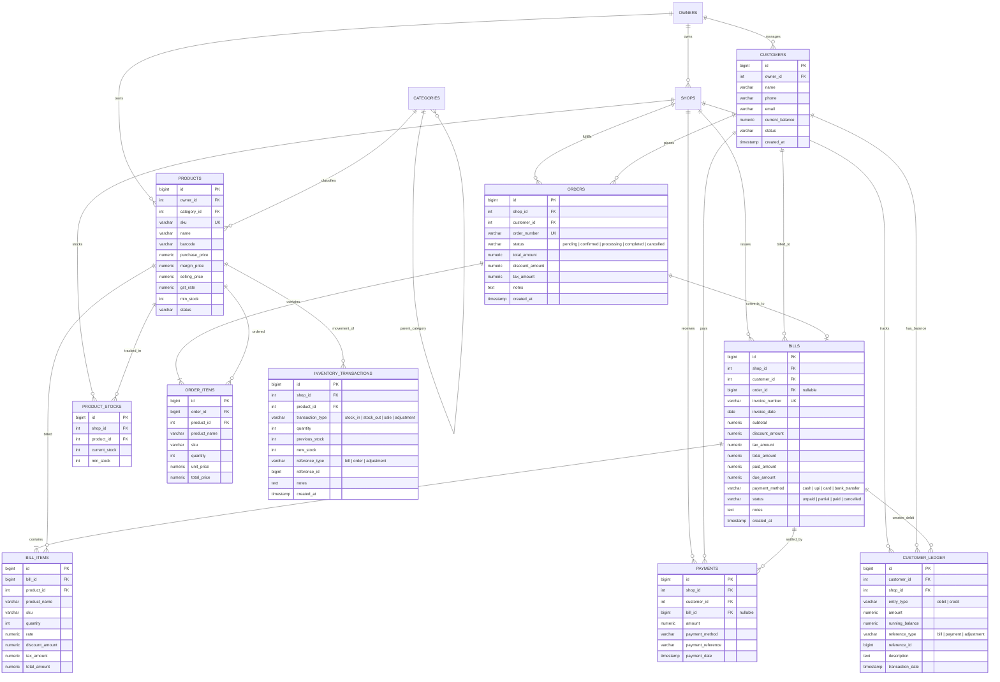

# NSYU Business — Database Relationships & Schema Architecture

**Workflow Foundation:** Cart → Order → Bill → Customer Ledger → Inventory Update  
**Engine:** PostgreSQL (Supabase)  

---

## 1. Entity-Relationship Diagram (ERD)

---

## 2. Business Workflow Specifications

### Step 1: Cart (Client Application)
- **Origin:** Real-time state maintained in Web and Flutter clients.
- **Product Retrieval:** Fetches authoritative product pricing, margin, and stock rules directly from `products` and `product_stocks`.
- **Validation:** Ensures `quantity >= 1`, prevents non-numeric/negative quantities, and validates against `product_stocks.current_stock`.
- **Live Calculation:** Dynamically computes:
  $$\text{Subtotal} = \sum (\text{rate} \times \text{quantity})$$
  $$\text{Grand Total} = \text{Subtotal} - \text{Discount} + \text{Tax}$$

### Step 2: Order (`orders` & `order_items`)
- When user places an order, an atomic transaction inserts:
  1. Header record in `orders` with sequential `order_number` (e.g. `ORD-000001`).
  2. Individual item rows in `order_items`.
- Status lifecycle: `pending` $\rightarrow$ `confirmed` $\rightarrow$ `processing` $\rightarrow$ `completed` / `cancelled`.

### Step 3: Bill (`bills` & `bill_items`)
- Created either directly from Cart ("Create Bill") or converted from a confirmed Order.
- Assigns sequential unique `invoice_number` from `invoice_counters` (e.g. `INV-NSYU-000001`).
- Records item snapshots in `bill_items`.
- Sets initial financial state:
  - If Credit / Udhaar: `paid_amount = 0.0`, `due_amount = total_amount`, `status = 'unpaid'`.
  - If Partial: `paid_amount = X`, `due_amount = total_amount - X`, `status = 'partial'`.
  - If Full Payment: `paid_amount = total_amount`, `due_amount = 0.0`, `status = 'paid'`.

### Step 4: Customer Ledger (`customer_ledger`)
- **Debit Entry (Bill Generated):**
  - Appends row in `customer_ledger`:
    $$\text{entry\_type} = \text{'debit'}, \quad \text{amount} = \text{total\_amount}$$
    $$\text{running\_balance} = \text{previous\_balance} + \text{total\_amount}$$
- **Credit Entry (Payment Received):**
  - When payment is made:
    $$\text{entry\_type} = \text{'credit'}, \quad \text{amount} = \text{paid\_amount}$$
    $$\text{running\_balance} = \text{previous\_balance} - \text{paid\_amount}$$
- Updates `customers.current_balance` synchronously.

### Step 5: Inventory Update (`inventory_transactions` & `product_stocks`)
- For every item on confirmed bill:
  1. Decrements `product_stocks.current_stock`:
     $$\text{current\_stock}_{\text{new}} = \text{current\_stock}_{\text{old}} - \text{quantity}$$
  2. Appends immutable audit entry in `inventory_transactions`:
     $$\text{transaction\_type} = \text{'sale'}, \quad \text{quantity} = -\text{quantity}$$
- Triggers operational low-stock notification if $\text{current\_stock} \le \text{min\_stock}$.
