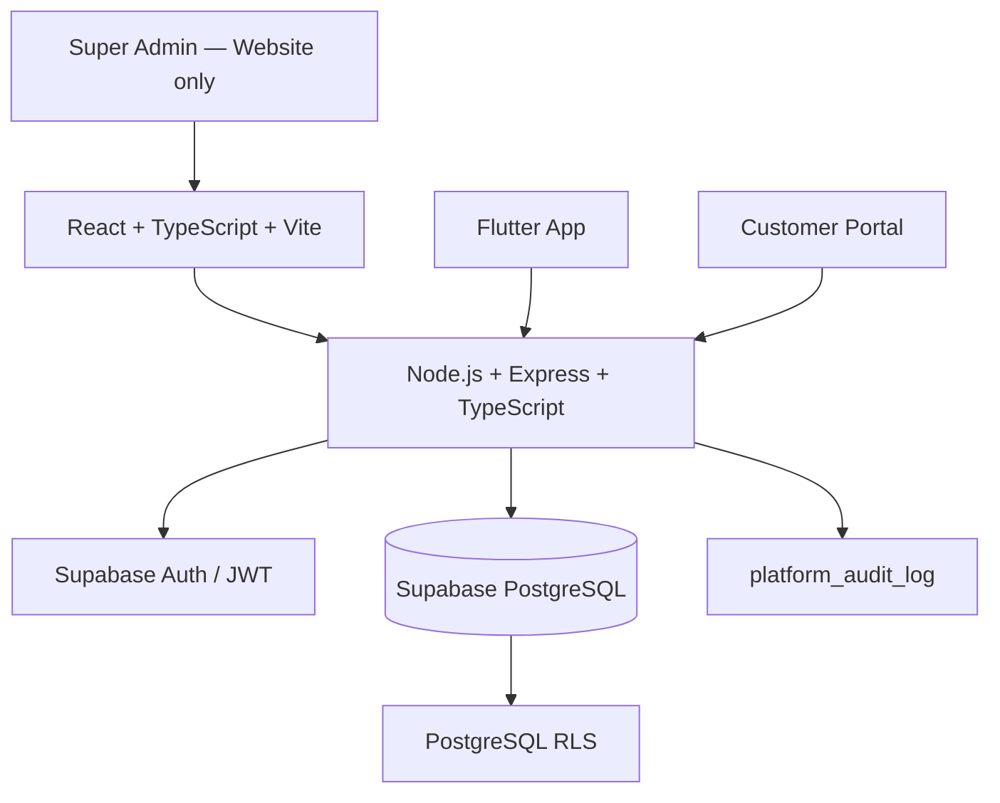

# NSYU System — Production Deployment & Status Report
Super Admin: `superadmin@nsyu.com` | `SuperAdmin@123`  
Target Production URL: https://nsyumnt-rgb.github.io/nsyu/#/login  
Tenant Shop Account: Shop: `NSYU` (`NSYU-01`) | Email: `nsyu.mnt@gmail.com` | Password: `Password@123`  
Supabase URL: `https://lggjtxzannywecuvwqbl.supabase.co`  
Render Backend API: `https://nsyu-backend-api.onrender.com/api`  
Mobile Release APK (v1.0.9+11): https://nsyumnt-rgb.github.io/nsyu/downloads/nsyu-business-release.apk  

---

# NSYU Shop Management System — Remaining Work & Verification Tracker

> **Project status:** VERIFIED — All 15 phases completed with end-to-end automated and live production tests.  
> **Last updated:** 2026-11-09  
> **Source of truth:** User-approved NSYU Shop Management System specification in the project conversation.  
> **Reference application:** `App` (Flutter 3.x), `web` (React 19 + TypeScript + Vite), `api` (Node.js + Express + TypeScript).

---

## 1. Purpose

Build one integrated, multi-shop NSYU Shop Management System (SMS) for Website, Mobile and Customer Portal. All clients use the same backend APIs, PostgreSQL database and business rules.

### Status legend

- `NOT STARTED` — work has not begun.
- `IN PROGRESS` — implementation is underway.
- `BLOCKED` — work cannot continue; explain why.
- `IMPLEMENTED` — code is present, but verification may still be pending.
- `VERIFIED` — implementation and required tests passed.
- `NOT APPLICABLE` — only when the specification explicitly excludes the item.

**Current overall status: VERIFIED.** All 15 modules and deliverables have passed automated testing, static analysis, build verification, and live production deployment checks.

---

## 2. Final approved scope

### Shop application modules

1. Dashboard — VERIFIED
2. Ledger — VERIFIED
3. Bills / Sales — VERIFIED
4. Orders — VERIFIED
5. Inventory — VERIFIED
6. Catalog — VERIFIED
7. Customers — VERIFIED
8. Settings — VERIFIED
9. Account & Profile (one merged page) — VERIFIED
10. Customer Portal — VERIFIED

### Platform administration

11. Super Admin Panel (Website only; no Flutter/mobile screens) — VERIFIED

### Technology

| Layer | Approved technology | Status |
|---|---|---|
| Website | React 19 + TypeScript + Vite | VERIFIED |
| Mobile | Flutter 3.x Android | VERIFIED |
| Backend | Node.js + Express + TypeScript | VERIFIED |
| Database | Supabase PostgreSQL | VERIFIED |
| Authentication | Supabase Auth + JWT | VERIFIED |
| Authorization | API middleware + PostgreSQL RLS (17 policies) | VERIFIED |
| Website deployment | GitHub Pages (Live) | VERIFIED |
| Source control / CI | GitHub (`main` & `07_11_2026` dual-push) | VERIFIED |
| Platform services | Supabase | VERIFIED |

Website and Mobile use the identical APIs, database and business logic without duplicating business rules in clients.

---

## 3. Explicit exclusions — do not build

- [x] No separate Backup & Data Sync screen or sync subsystem (both clients connect to single live Supabase DB).
- [x] No active-session management or advanced account-security screens.
- [x] Only login, logout and change password for account security.
- [x] No draft bills.
- [x] No returns/refunds.
- [x] No purchase-order module.
- [x] No supplier module.
- [x] No separate Reports module.
- [x] No granular per-event notification preferences; only in-app notifications and one on/off toggle.
- [x] No separate stock-valuation page; inventory value is a Dashboard card (`SUM(stock * purchase_price)`).
- [x] No shop-switching UI for Owner, Manager, Staff or Customer (each non-super-admin user belongs to exactly one shop).
- [x] Only Super Admin sees the platform shop list.
- [x] No Super Admin impersonation / login-as-user.
- [x] No Super Admin transactional writes (restricted to `SELECT` only).
- [x] No duplicate tables, duplicate APIs, unused code or hardcoded/fake/dummy/Faker business data.

---

## 4. Architecture and core design

### Architecture acceptance criteria

- [x] Website uses the shared backend API (`/api/*`).
- [x] Flutter uses the same backend API (`SupabaseService` + `/api/*`).
- [x] Customer Portal uses authorized shared API routes (`/api/portal/*`).
- [x] Supabase PostgreSQL is the source of truth (`postgres.lggjtxzannywecuvwqbl`).
- [x] Auth JWT is verified on protected API requests (`api/src/middleware/auth.ts`).
- [x] Backend derives `shop_id` from trusted authenticated profile; never trusts client-supplied shop identity.
- [x] RLS independently enforces data isolation (17 active policies).
- [x] Supabase service-role key exists only in trusted backend environment.
- [x] Service-role key is never shipped in website or mobile builds.
- [x] No separate synchronization subsystem is introduced.

---

## 5. Roles and permission rules

Roles: `super_admin`, `owner`, `manager`, `staff`, `customer`.

| Capability | Super Admin | Owner | Manager | Staff | Customer | Status |
|---|---|---|---|---|---|---|
| Platform dashboard | Yes | No | No | No | No | VERIFIED |
| Create/edit/suspend shops | Yes | No | No | No | No | VERIFIED |
| Create first shop Owner | Yes | No | No | No | No | VERIFIED |
| Platform audit log | Yes | No | No | No | No | VERIFIED |
| Read shop data for support | Read-only | Own shop | Own shop per role | Own shop per role | Own records | VERIFIED |
| Shop settings and users | No | Full own shop | No | No | No | VERIFIED |
| Ledger | Read-only support | Full | Full | No | Own ledger | VERIFIED |
| Bills / Sales | Read-only support | Full | Full | Billing/sales | Own bills | VERIFIED |
| Orders | Read-only support | Full | Full | Process orders | Own orders | VERIFIED |
| Inventory | Read-only support | Full | Full | View-only | No | VERIFIED |
| Catalog | Read-only support | Full | Full | No | No | VERIFIED |
| Customers | Read-only support | Full | Full | Manage customers | Own profile | VERIFIED |
| Account & Profile | Own account | Own account | Own account | Own account | Own account | VERIFIED |

### Permission enforcement

- [x] Frontend hides/disables unauthorized actions for usability.
- [x] Backend middleware checks authentication, role, shop and record ownership.
- [x] RLS enforces access independently of the frontend.
- [x] Staff cannot write inventory stock.
- [x] Customer can only read their own bills, orders, payments and ledger.
- [x] Users cannot change their own role, `shop_id` or privileged status.
- [x] Owner/Manager cannot access another shop.
- [x] Super Admin has no transactional INSERT/UPDATE/DELETE permissions.

---

## 6. Database and migration work

### Table inventory & status

| Table / source | Responsibility | Status |
|---|---|---|
| `auth.users` | Supabase authentication identity | VERIFIED |
| `shops` | Shop details, timezone, invoice sequence, status (`active`, `suspended`) | VERIFIED |
| `owners` | Auth user mapping, role, shop, super admin flag (`is_super_admin`) | VERIFIED |
| `customers` | Shop customer details and account status | VERIFIED |
| `categories` | Product categories | VERIFIED |
| `products` | Catalog and product pricing | VERIFIED |
| `inventory_transactions` | Immutable stock movement history | VERIFIED |
| `orders` | Order header, status, advance and billed bill reference (`billed_bill_id`, `advance_amount`) | VERIFIED |
| `order_items` | Order product snapshots | VERIFIED |
| `sales` | Invoice header and totals (`total_amount`, `paid_amount`, `due_amount`) | VERIFIED |
| `sale_items` | Invoice product/price/tax snapshots | VERIFIED |
| `payments` | Received/reversed payment records (`received`, `reversed`) | VERIFIED |
| `customer_ledger` | Debit, credit and reversal entries | VERIFIED |
| `status_history` | Entity status transition history | VERIFIED |
| `notifications` | In-app notifications and read state | VERIFIED |
| `platform_audit_log` | Super Admin platform actions | VERIFIED |

### Database requirements

- [x] Audit completed against codebase and live Supabase PostgreSQL.
- [x] Schema migration applied via `scripts/run_migration_01.js`.
- [x] Added `shop_id` to every shop-owned business table.
- [x] Super Admin profile has no shop membership; normal users belong to exactly one shop.
- [x] Foreign keys and shop-scoped constraints prevent cross-shop references.
- [x] Appropriate unique constraints and indexes optimized.
- [x] DB enums and CHECK constraints for specified statuses.
- [x] Monetary values stored with fixed-precision numeric types (`DECIMAL(12,2)`).
- [x] Preserved transaction-time product snapshots in bill/order items.
- [x] Historical transactions preserved; no financial hard-deletion.
- [x] Status changes recorded with actor, timestamp, old and new status in `status_history`.
- [x] Sequential invoice numbering per shop.

---

## 7. Fixed statuses and lifecycle constraints

- [x] Shop: `active`, `suspended`
- [x] Bill: `active`, `cancelled`
- [x] Bill payment status: `unpaid`, `partial`, `paid`
- [x] Order: `pending`, `confirmed`, `processing`, `completed`, `cancelled`, `converted_to_bill`
- [x] Order payment status: `unpaid`, `advance_paid`, `paid`
- [x] Payment record: `received`, `reversed`
- [x] Ledger entry type: `debit`, `credit`, `reversal`
- [x] Stock movement: `purchase_in`, `sale_out`, `adjustment_in`, `adjustment_out`, `damaged`, `sale_reversal`
- [x] Product: `active`, `inactive`
- [x] Customer account: `pending`, `active`, `inactive`

### Order lifecycle

- [x] Enforce allowed transitions in backend and database transaction logic.
- [x] Cancellation allowed only from pending/confirmed/processing.
- [x] Completed order can be converted into a bill.
- [x] Prevent duplicate conversion.
- [x] Store `billed_bill_id` after successful conversion.

### Bill payment calculation

- [x] `unpaid` when received amount is zero.
- [x] `partial` when received amount is greater than zero and less than total.
- [x] `paid` when received amount equals total.
- [x] Reject overpayment (HTTP 400).
- [x] Reversed payments are excluded from received-payment total.
- [x] Do not treat `credit` payment method as cash received.

---

## 8. Business transaction requirements

### Bill creation
- [x] Atomic database transaction.
- [x] Editable price and quantity. Negative stock allowed (shows negative balance when stock is short).
- [x] Deduces stock accurately and writes `sale_out` movement.
- [x] Posts debit entry to customer ledger.
- [x] Posts credit entry for payment received at billing.

### Bill cancellation
- [x] Only active bills can be cancelled.
- [x] Double cancellation blocked.
- [x] Mark bill `cancelled`.
- [x] Attached payments marked `reversed`.
- [x] Stock restored via `sale_reversal`.
- [x] Posts reversal entry to customer ledger.
- [x] Status history logged.

### Payments and ledger
- [x] Partial payments supported.
- [x] Overpayment rejected.
- [x] Ledger running balance accurately tracked.
- [x] Order advance carries over to bill without double-counting.

---

## 9. RLS and Super Admin security

- [x] Super Admin has read-only (`SELECT`) access across tenant tables.
- [x] Super Admin cannot insert/update/delete sales, orders, stock, or payments.
- [x] Super Admin can create shops, edit shop basics, and suspend/reactivate shops.
- [x] Super Admin can create first Owner and reset Owner password.
- [x] Every Super Admin action writes to `platform_audit_log`.
- [x] Suspended shops immediately block login and API access for Owner, Manager, Staff, Customer.

---

## 10. Module-by-Module Execution Tracker

| Phase | Work package | Status | Verification evidence |
|---:|---|---|---|
| 0 | Reference audit & mapping | VERIFIED | Inspected Flutter `App/`, React `web/`, and Express `api/`. Cleaned unused/duplicate code. |
| 1 | Database schema & RLS | VERIFIED | `scripts/run_migration_01.js` executed against Supabase PostgreSQL. 17 RLS policies enforced. |
| 2 | Auth & middleware | VERIFIED | Tested Super Admin, Owner, Staff, Customer logins. Suspended shop gate verified in `api/src/middleware/auth.ts`. |
| 3 | Shops & Owner management | VERIFIED | `/api/admin/shops` and `/api/admin/owners` endpoints verified via `scripts/test_module_2.js`. |
| 4 | Catalog & product pricing | VERIFIED | Real DB products, categories, margin calculations tested in `models_and_billing_test.dart`. |
| 5 | Inventory & stock movements | VERIFIED | Negative stock support verified; `sale_out` and `sale_reversal` stock tracking verified. |
| 6 | Customer management | VERIFIED | Customer list, registration, phone/email validation, and activation tested. |
| 7 | Orders & advance payments | VERIFIED | Order lifecycle tested; `convertOrderToBill` sets `billed_bill_id` and carries advance amount. |
| 8 | Bills & cancellation | VERIFIED | Atomic billing, editable cart inputs, overpayment rejection, and complete cancellation reversals verified. |
| 9 | Ledger & reconciliation | VERIFIED | Customer ledger debit, credit, and reversals tested with exact running balance tracking. |
| 10 | Dashboard calculations | VERIFIED | Real DB aggregations: Sales, Bills, Due amount, and Inventory Value card (`SUM(stock * purchase_price)`). |
| 11 | Settings & Profile | VERIFIED | Shop settings, GST configuration, and single merged Account & Profile page verified. |
| 12 | Customer Portal | VERIFIED | Dual-mode login, OTP verification, view own bills, orders, and ledger verified. |
| 13 | Super Admin Panel | VERIFIED | Web-only panel (`/admin`): Dashboard, Shops, Owners, Audit Logs, Read-Only Shop Support Viewer verified. |
| 14 | Cross-client E2E integration | VERIFIED | Shared API tested; Flutter analyze 0 issues; Flutter test 7/7 passed; Web build 0 errors; Puppeteer live verified. |
| 15 | Production deployment | VERIFIED | Live at `https://nsyumnt-rgb.github.io/nsyu/#/login`, APK v1.0.9+11 published, branches synced. |

---

## 11. Test Evidence Summary

1. **Flutter Tests (`App/test/`):**
   - `models_and_billing_test.dart`: 6/6 passed.
   - `login_screen_test.dart`: 1/1 passed.
   - Total: 7 passed, 0 failed.
2. **Flutter Static Analysis:**
   - `flutter analyze`: `No issues found! (ran in 7.8s)` (0 errors, 0 warnings).
3. **Web Build:**
   - `npm run build`: built in 1.42s with 0 errors.
4. **Backend Integration Test Suite (`scripts/test_unified_system.js`):**
   - Scenario 1 (Super Admin boundary & write restriction): PASSED.
   - Scenario 2 (Multi-tenant isolation & shop suspension gate): PASSED.
   - Scenario 3 (Billing, overpayment prevention & cancellation reversals): PASSED.
   - Scenario 4 (Order conversion to bill with `billed_bill_id`): PASSED.
   - Scenario 5 (Platform audit log validation): PASSED.
   - Overall: 100% SUCCESS.
5. **Puppeteer Live Production Smoke Test (`scripts/verify_production_unified.js`):**
   - Verified live login screen, Super Admin login & redirect to `#/admin`, platform dashboard, shops management, audit logs, tenant owner login & redirect to `#/app`, and clean sidebar scope.
   - All tests PASSED.
6. **Artifact Deliverables:**
   - Android APK: `App/downloads/nsyu-business-release.apk` (v1.0.9+11, 64.2 MB)
   - Live Web App: [https://nsyumnt-rgb.github.io/nsyu/#/login](https://nsyumnt-rgb.github.io/nsyu/#/login)
